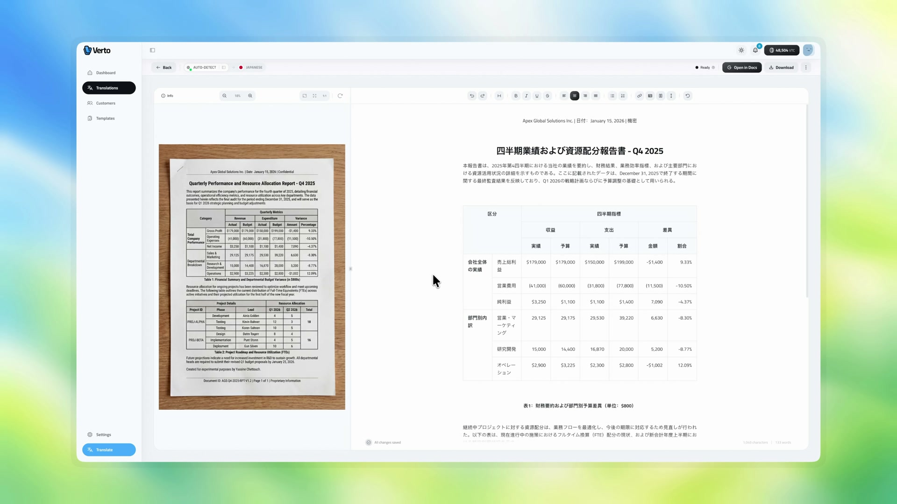
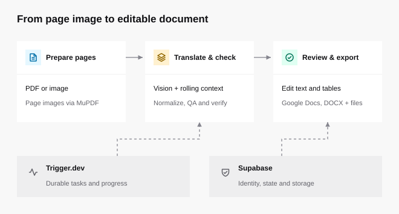

# Verto

Document translation with editable tables and structured exports.

<!-- x-release-please-start-version -->

[](https://github.com/yaschet/verto/actions/workflows/ci.yml)
[](https://github.com/yaschet/verto/releases)
[](LICENSE)

<!-- x-release-please-end -->

<a href="https://yaschet.com/case-studies/verto">
  
</a>

Verto takes a scanned document through translation, review and export. Text and table structure share one document model, so a reviewer can edit cells, headings and paragraphs before generating a Google Doc and downloadable files.

Designed and built by [Yassine Chettouch](https://yaschet.com).
[Watch the case-study film](https://www.yaschet.com/case-studies/verto) or read the [engineering handbook (PDF)](https://www.yaschet.com/handbooks/verto-engineering-handbook.pdf). The handbook documents the January 2026 handover; use the [architecture guide](docs/architecture.md) to navigate this release checkout.

## How it works

<picture>
  <source media="(prefers-color-scheme: dark)" srcset=".github/assets/document-workflow-dark.svg">
  
</picture>

1. **Prepare pages.** MuPDF renders PDF pages into images. Image uploads enter the same translation path.
2. **Translate with context.** The vision adapter batches pages, carries entity and terminology context, and requests a structured response from OpenAI.
3. **Normalize and check.** Core transforms recover parsable JSON, repair table grids and sanitize editor nodes. QA and verification adapters inspect translated content.
4. **Review.** The TipTap workspace supports merged cells, text alignment, block editing and right-to-left reading direction.
5. **Export.** A Google Docs mapper generates a native document; the Drive adapter requests export formats and stores results in Supabase.

The [architecture guide](docs/architecture.md) describes boundaries and failure handling.

## Run locally

Use the Node version in [.node-version](.node-version) and pnpm from `packageManager`.

```sh
npm install --global pnpm@10.22.0
pnpm install --frozen-lockfile
pnpm check
pnpm build:offline
pnpm start:offline
```

Open [the local preview](http://localhost:3000/preview). Choose English, Arabic or Japanese and edit the synthetic document. Changes live in the browser and are discarded when you reload. The offline commands load inert example configuration and block external network connections; they do not translate or export documents.

For development without a production build:

```sh
pnpm dev:offline
```

To run the connected application, follow [setup](docs/setup.md) and supply your own service accounts. Every setting is listed in [configuration](docs/configuration.md) and [.env.example](.env.example).

## Stack and boundaries

| Area                     | Implementation                                 |
| ------------------------ | ---------------------------------------------- |
| Application              | Next.js, React, TypeScript, Tailwind CSS       |
| Review                   | TipTap and ProseMirror                         |
| Core transforms          | Framework-independent modules in `src/engine/` |
| Durable work             | Trigger.dev tasks in `trigger/`                |
| Identity, state, storage | Supabase                                       |
| Translation              | OpenAI vision and structured responses         |
| Document generation      | Google Docs and Drive APIs                     |
| Payments and email       | Stripe and Resend adapters                     |

## Verification

`pnpm check` runs formatting, lint, strict types and offline engine tests with coverage. The suite covers table repair, document sanitization, JSON recovery and batch sizing. Thresholds apply to those transforms, not to the full application. The coverage report identifies the measured files.

CI also builds with inert configuration, scans Git history for secrets, checks dependency advisories, validates documentation and enforces Conventional Commit PR titles. CodeQL, dependency review and Scorecard run when the repository is public.

## Decisions

- [Vision and a structured intermediate document](docs/decisions/0001-document-representation.md)
- [Durable task boundaries](docs/decisions/0002-durable-tasks.md)
- [Editable review and native exports](docs/decisions/0003-native-exports.md)
- [Offline evaluation](docs/decisions/0004-offline-evaluation.md)
- [Service configuration](docs/decisions/0005-service-configuration.md)
- [Distribution and licensing](docs/decisions/0006-source-distribution.md)

## Known limitations and production hardening

- Model output requires human review. Layout, language and table complexity can affect the result. There is no fidelity or translation-accuracy guarantee.
- The offline preview demonstrates editing using synthetic fixtures. Live translation, storage, email, billing and exports require configured services and can incur costs.
- Automated coverage focuses on core transforms. It does not certify live providers, billing or every editor interaction. Database isolation, concurrent refunds, repeated webhooks, task recovery and partial export failures are not covered by a repeatable integration suite; these are next steps before a production deployment.
- Google Docs supports a different layout model from a PDF. Exports preserve editable structure where the mapper supports it; they do not reproduce every visual detail.
- Production credentials, accounts, customer documents, operational data and a hosted service are omitted.
- Medium and low dependency advisories remain in development tools and runtime transitive packages. CI blocks high and critical findings; remaining alerts need compatible upgrades or documented reachability review. Run `pnpm audit` for the current dependency graph.
- Google Docs masters are viewable by anyone with their link; keep those links private when documents are sensitive. Use **Make a copy** to edit a separate copy in your own Google Drive; Verto itself does not require Google sign-in, while saving a copy requires a Google account. Existing documents created by an older deployment retain their sharing settings until its operator changes them.
- MuPDF has its own licensing obligations. A Verto commercial license does not grant rights to third-party software.

Check the tag’s **Verified** status against [the maintainer’s signing identity](https://github.com/yaschet), or configure that trusted SSH key in `gpg.ssh.allowedSignersFile` and run `git verify-tag v1.0.0` locally.

## Read more

[Setup](docs/setup.md) · [Configuration](docs/configuration.md) · [Architecture](docs/architecture.md) · [Current handbook (PDF)](https://www.yaschet.com/handbooks/verto-engineering-handbook.pdf) · [v1.0.0 handbook snapshot](handbook/verto-engineering-handbook.pdf) · [Contributing](CONTRIBUTING.md) · [Security](SECURITY.md)

## License

Verto is **source-available** under [PolyForm Noncommercial](LICENSE). You may read, run and modify it for personal, educational and evaluation use that meets the license's noncommercial conditions. Commercial use requires a separate [commercial license](COMMERCIAL.md).

The handbook is licensed separately under [CC BY-NC-ND](handbook/LICENSE): share it with attribution for noncommercial purposes; distributing adapted editions requires permission. Dependencies retain their own licenses; see [third-party notices](THIRD_PARTY_NOTICES.md).
